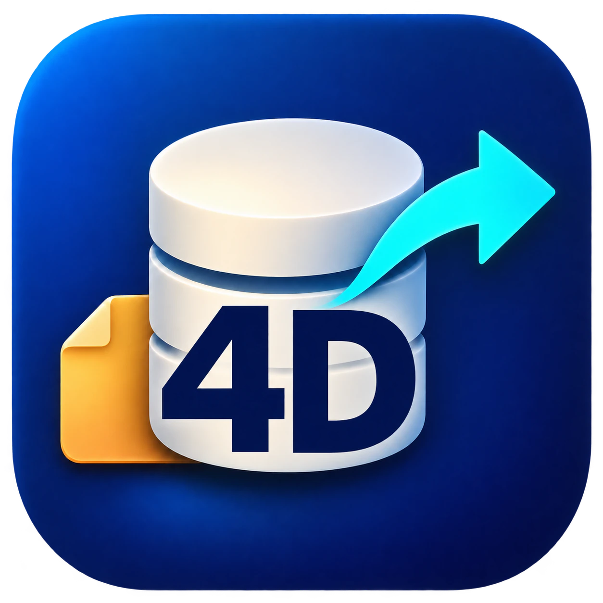
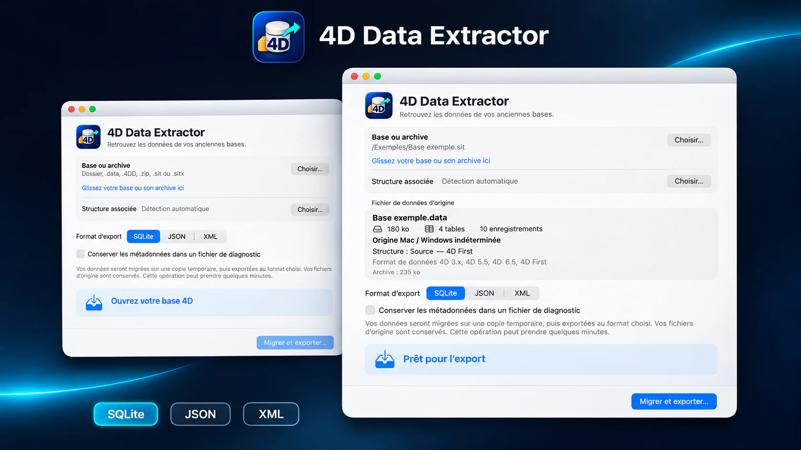
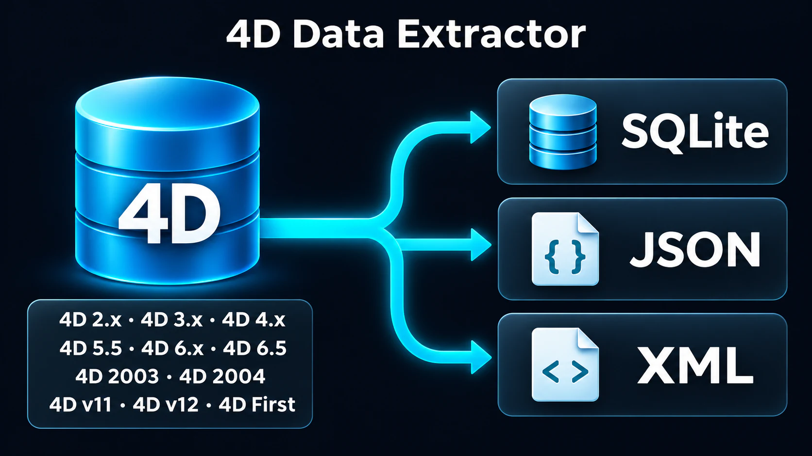

<h1 align="center">4D Data Extractor</h1>

<strong>Geben Sie Ihren älteren 4D-Datenbanken eine Zukunft.</strong>

<a href="README.md">English</a> · <a href="README.fr.md">Français</a> · <a href="README.es.md">Español</a> · <a href="README.de.md">Deutsch</a>

<a href="https://rea.com.co/de/applications/4d-data-extractor/">Produktwebsite</a> · <a href="https://github.com/rea-studio-repos/4d-data-extractor/releases">Downloads</a> · <a href="https://github.com/rea-studio-repos/4d-data-extractor/wiki">Wiki</a>

4D Data Extractor öffnet eine Kopie Ihrer Datenbank, erkennt ihre Tabellen und führt Sie zu aktuellen Formaten, ohne die Originale zu verändern.

**macOS 14+ (Apple Silicon) · Windows 10 / 11 · REA Studio**

## Funktionen

- **Arbeit mit einer Kopie** — Analyse und Export erfolgen mit der von Ihnen gewählten Kopie. Die ursprüngliche Datenbank wird nicht verändert.
- **Quell- oder kompilierte Datenbanken** — Die App sucht in erkannten Quell- und kompilierten Datenbanken nach verfügbaren Strukturen und Daten.
- **Drei Ausgabeformate** — Führen Sie Tabellen in einer SQLite-Datenbank zusammen oder exportieren Sie sie als JSON und XML.
- **Anpassbare Exporte** — Erstellen Sie für JSON und XML einen gemeinsamen Satz oder eine Datei pro Tabelle – mit einer Begrenzung der Datensätze je Datei.
- **Diagnose bei Bedarf** — Aktivieren Sie die Metadatendiagnose, wenn Sie die Analyse der Datenbank vertiefen möchten.
- **Keine alte 4D-Installation** — Stellen Sie Daten bereit, ohne eine alte 4D-Version zu installieren oder Datenbankmethoden auszuführen.

## Exportformate

| SQLite | JSON | XML |
| :---: | :---: | :---: |
| .sqlite | .json | .xml |

Wechseln Sie zu einer direkt abfragbaren Datenbank oder zu Dateien, die sich leicht in Werkzeuge, Abläufe und Archive integrieren lassen.

## Kompatibilität

Die Übersicht der unterstützten Versionen finden Sie im Wiki. [Wiki →](https://github.com/rea-studio-repos/4d-data-extractor/wiki)

## Downloads

Verfügbare Installationsdateien finden Sie in den GitHub-Releases. Jede Version nennt die unterstützten Plattformen. [Releases →](https://github.com/rea-studio-repos/4d-data-extractor/releases)

---

<strong>REA Studio</strong> · <a href="https://rea.com.co/">rea.com.co</a>

