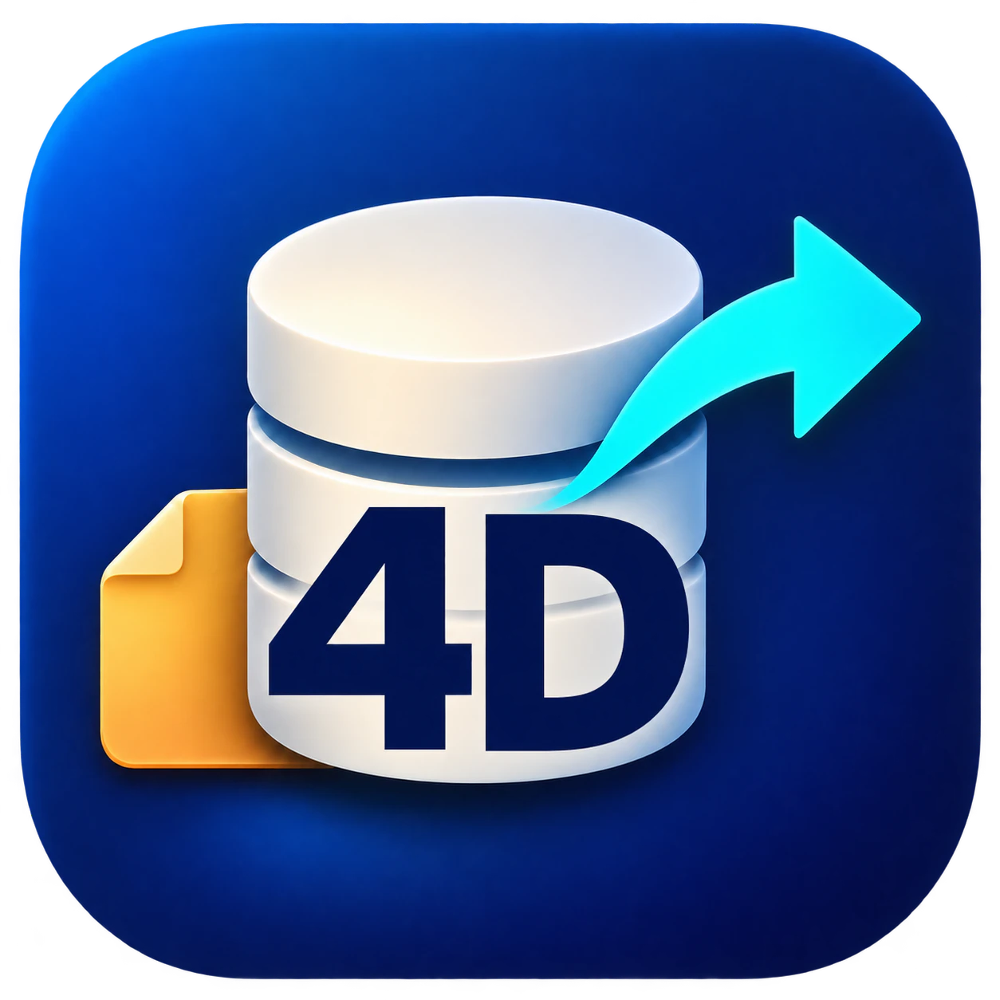
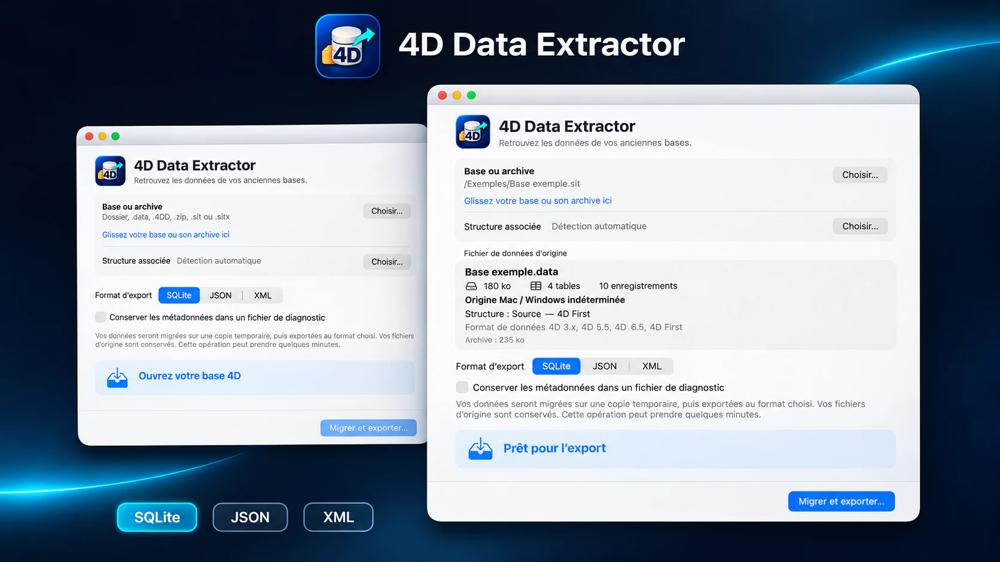
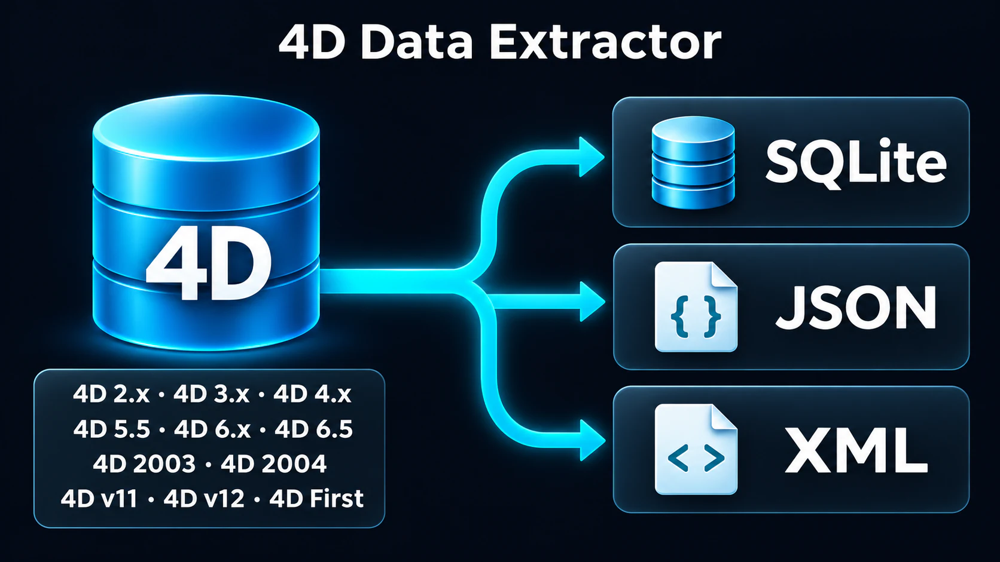

<h1 align="center">4D Data Extractor</h1>

<strong>Tus antiguas bases 4D vuelven a tener futuro.</strong>

<a href="README.md">English</a> · <a href="README.fr.md">Français</a> · <a href="README.es.md">Español</a> · <a href="README.de.md">Deutsch</a>

<a href="https://rea.com.co/applications/4d-data-extractor/">Sitio oficial</a> · <a href="https://github.com/rea-studio-repos/4d-data-extractor/releases">Descargas</a> · <a href="https://github.com/rea-studio-repos/4d-data-extractor/wiki">Wiki</a>

4D Data Extractor abre una copia de tu base, identifica sus tablas y te guía hacia formatos actuales sin modificar los originales.

**macOS 14+ (Apple Silicon) · Windows 10 / 11 · REA Studio**

## Funciones

- **Trabajo sobre una copia** — El análisis y la exportación se realizan sobre la copia que eliges. La base original no se modifica.
- **Bases fuente o compiladas** — La aplicación busca las estructuras y los datos disponibles en bases fuente y compiladas reconocidas.
- **Tres formatos de salida** — Reúne las tablas en una base SQLite o expórtalas a JSON y XML.
- **Exportaciones ajustables** — Para JSON y XML, crea un conjunto agrupado o un archivo por tabla, con un límite de registros por archivo.
- **Diagnóstico cuando lo necesites** — Activa el diagnóstico de metadatos cuando quieras profundizar en el análisis de la base.
- **Sin instalar un 4D antiguo** — Recupera los datos sin instalar una versión antigua de 4D y sin ejecutar los métodos de la base.

## Formatos de exportación

| SQLite | JSON | XML |
| :---: | :---: | :---: |
| .sqlite | .json | .xml |

Pasa a una base que puedes consultar directamente o a archivos fáciles de integrar en tus herramientas, procesos y archivos históricos.

## Bases de Mac OS Classic: conservar los forks de recursos

Para una base procedente de Mac OS Classic, recomendamos reunir la estructura y el archivo de datos en un archivo SIT o SITX creado desde un Mac antiguo o un emulador que ejecute Mac OS Classic. Así se conservan los forks de recursos durante la transferencia a Mac o Windows.

A veces es posible recuperar los datos aunque los forks de recursos falten o estén dañados, siempre que la estructura y los datos necesarios sigan siendo legibles.

4D Data Extractor abre directamente los archivos SIT y las variantes SITX compatibles con sus lectores integrados, sin descomprimirlos previamente en otro programa.

## Compatibilidad

Consulta la tabla de versiones compatibles en el wiki. [Wiki →](https://github.com/rea-studio-repos/4d-data-extractor/wiki)

## Descargas

Encuentra los instaladores disponibles en las releases de GitHub. Cada release indica las plataformas compatibles. [Releases →](https://github.com/rea-studio-repos/4d-data-extractor/releases)

---

<strong>REA Studio</strong> · <a href="https://rea.com.co/">rea.com.co</a>

