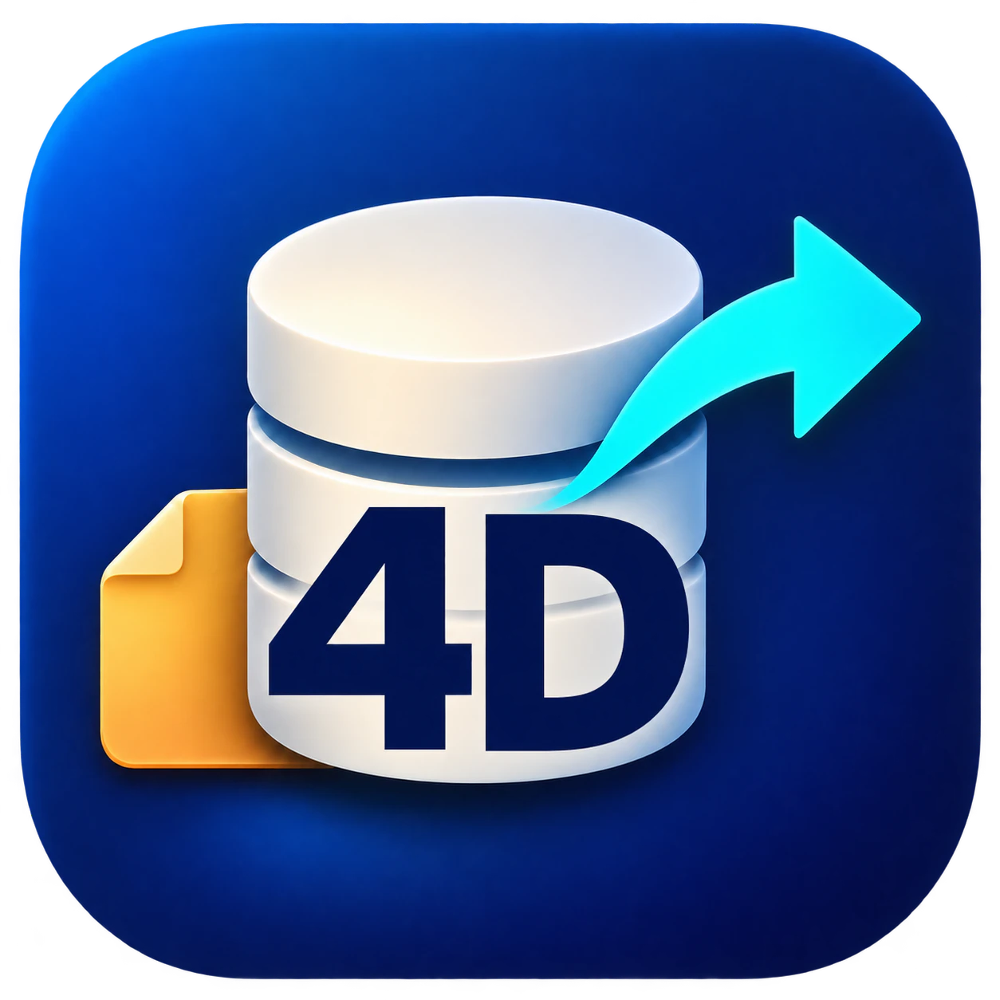
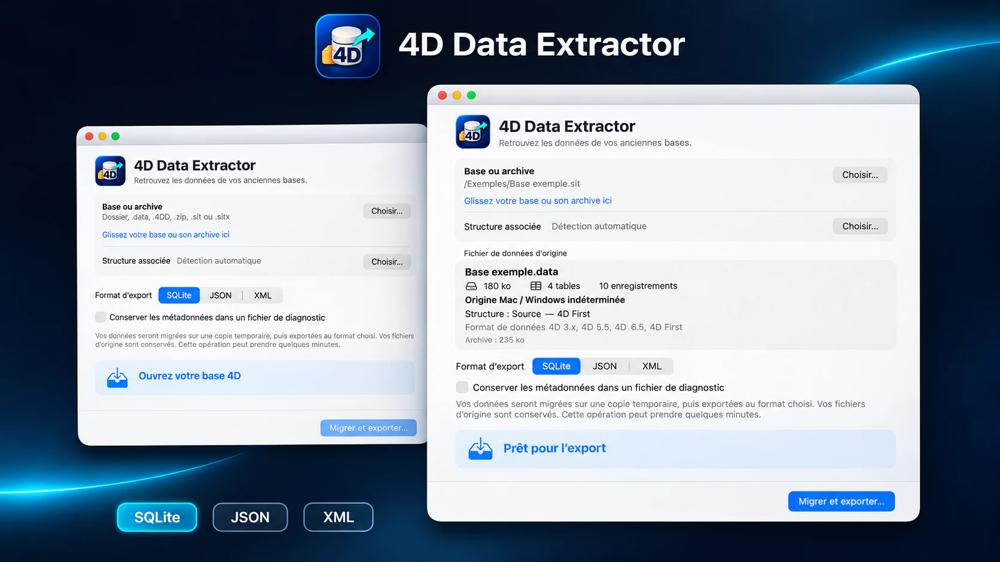
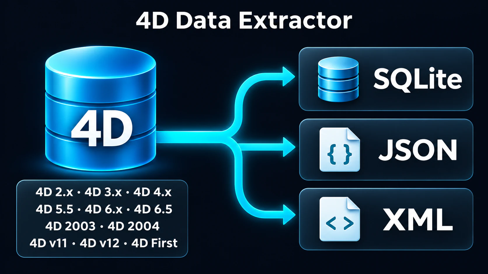

<h1 align="center">4D Data Extractor</h1>

<strong>Vos anciennes bases 4D retrouvent un avenir.</strong>

<a href="README.md">English</a> · <a href="README.fr.md">Français</a> · <a href="README.es.md">Español</a> · <a href="README.de.md">Deutsch</a>

<a href="https://rea.com.co/fr/applications/4d-data-extractor/">Site officiel</a> · <a href="https://github.com/rea-studio-repos/4d-data-extractor/releases">Téléchargements</a> · <a href="https://github.com/rea-studio-repos/4d-data-extractor/wiki">Wiki</a>

4D Data Extractor ouvre une copie de votre base, identifie ses tables et vous accompagne jusqu’à des formats actuels, sans modifier les originaux.

**macOS 14+ (Apple Silicon) · Windows 10 / 11 · REA Studio**

## Fonctionnalités

- **Travail sur une copie** — L’analyse et l’export s’effectuent sur la copie que vous choisissez. La base d’origine n’est pas modifiée.
- **Bases sources ou compilées** — L’application recherche les structures et données disponibles dans les bases sources comme dans les bases compilées reconnues.
- **Trois formats de sortie** — Centralisez les tables dans une base SQLite ou exportez-les en JSON et XML.
- **Exports ajustables** — Pour JSON et XML, créez un ensemble regroupé ou un fichier par table, avec une limite d’enregistrements par fichier.
- **Diagnostic à la demande** — Activez le diagnostic des métadonnées lorsque vous souhaitez approfondir l’analyse de la base.
- **Sans ancienne installation 4D** — Récupérez les données sans installer une ancienne version de 4D et sans exécuter les méthodes de la base.

## Formats d’export

| SQLite | JSON | XML |
| :---: | :---: | :---: |
| .sqlite | .json | .xml |

Passez à une base directement interrogeable ou à des fichiers faciles à intégrer dans vos outils, traitements et archives.

## Bases Mac OS Classic : préserver les forks de ressources

Pour une base provenant de Mac OS Classic, il est préférable de réunir la structure et le fichier de données dans une archive SIT ou SITX créée depuis un ancien Mac ou un émulateur exécutant Mac OS Classic. Cette préparation préserve les forks de ressources lors du transfert vers Mac ou Windows.

Même si les forks de ressources sont manquants ou endommagés, une récupération peut parfois rester possible lorsque la structure et les données nécessaires sont encore lisibles.

4D Data Extractor ouvre directement les archives SIT et les variantes SITX compatibles avec ses lecteurs intégrés, sans décompression préalable dans un autre programme.

## Compatibilité

Consultez la grille des versions prises en charge dans le wiki. [Wiki →](https://github.com/rea-studio-repos/4d-data-extractor/wiki)

## Téléchargements

Retrouvez les installateurs disponibles dans les releases GitHub. Chaque release précise les plateformes prises en charge. [Releases →](https://github.com/rea-studio-repos/4d-data-extractor/releases)

---

<strong>REA Studio</strong> · <a href="https://rea.com.co/">rea.com.co</a>

