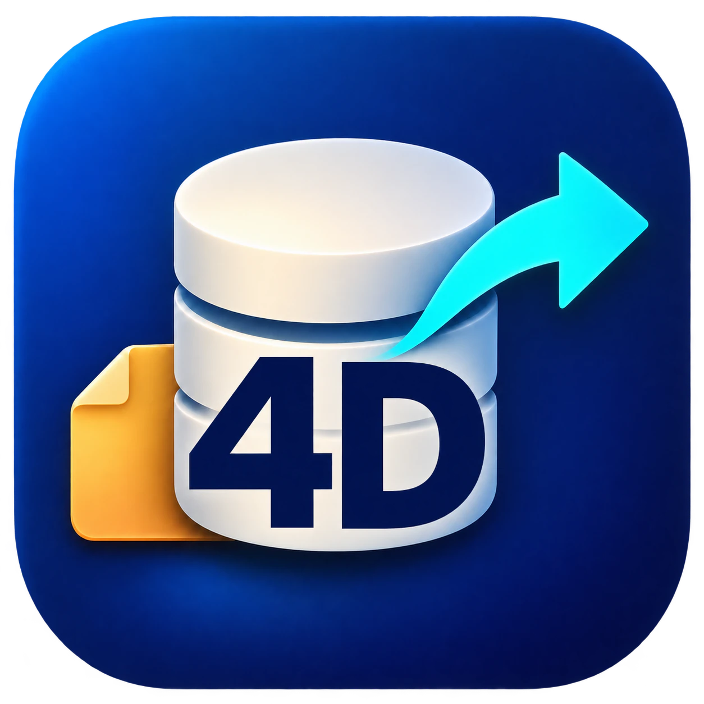
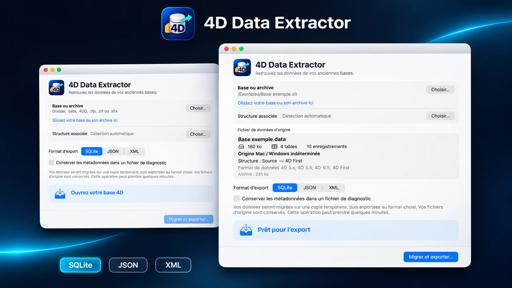
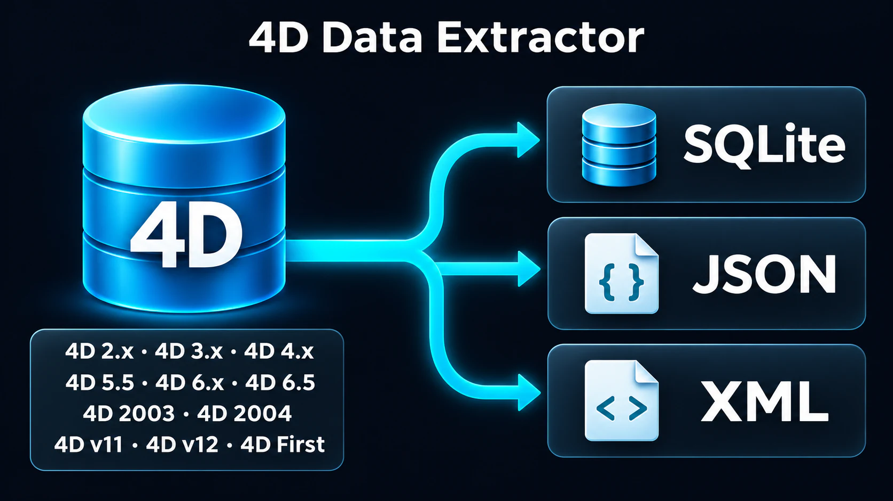

<h1 align="center">4D Data Extractor</h1>

<strong>Give your legacy 4D databases a future.</strong>

[English](README.md) · [Français](README.fr.md) · [Español](README.es.md) · [Deutsch](README.de.md)

<a href="https://rea.com.co/en/applications/4d-data-extractor/">Product website</a> · <a href="https://github.com/rea-studio-repos/4d-data-extractor/releases">Downloads</a> · <a href="https://github.com/rea-studio-repos/4d-data-extractor/wiki">Wiki</a>

4D Data Extractor opens a copy of your database, identifies its tables and guides you toward current formats without changing the originals.

**macOS 14+ · Apple Silicon · REA Studio**

## Features

- **Work from a copy** — Analysis and export run on the copy you select. The original database is not modified.
- **Source or compiled databases** — The app looks for available structures and data in recognised source and compiled databases.
- **Three output formats** — Bring tables together in a SQLite database or export them to JSON and XML.
- **Adjustable exports** — For JSON and XML, create one combined set or one file per table, with a record limit for each file.
- **Diagnostics when needed** — Enable metadata diagnostics when you want a deeper view of the database analysis.
- **No legacy 4D installation** — Recover data without installing an old 4D release and without running database methods.

## Export formats

| SQLite | JSON | XML |
| :---: | :---: | :---: |
| .sqlite | .json | .xml |

Move to a database you can query immediately or to files that are easy to integrate into tools, workflows and archives.

## Compatibility

Read the supported-version grid in the wiki. [Wiki →](https://github.com/rea-studio-repos/4d-data-extractor/wiki)

## Downloads

Get the latest installer from GitHub Releases when available. Each release lists its supported platforms. [Releases →](https://github.com/rea-studio-repos/4d-data-extractor/releases)

---

<strong>REA Studio</strong> · <a href="https://rea.com.co/">rea.com.co</a>

